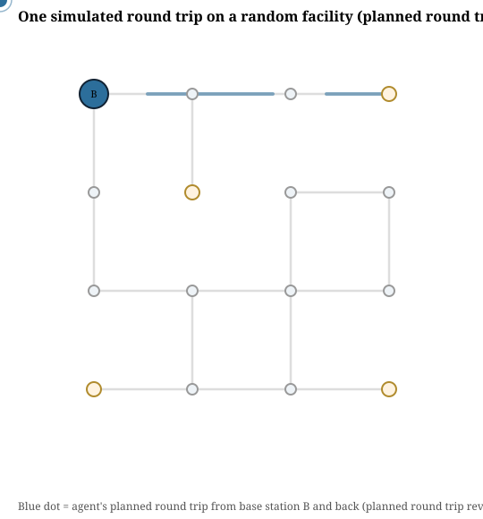
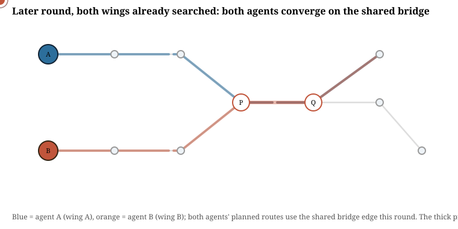

# Echo Corridors

Path-based sensors report a single boolean observation for an entire
traversed route: an agent that returns means "no hazard triggered along
this path," one that does not means "something happened, but not where."
Fusing many such observations into a spatial hazard belief map, and
choosing routes that gather information fastest, is the problem this
project implements and stress-tests.

This is an independent, from-scratch implementation of the Bayesian
network belief-update method described in Srivastava, Kontoudis, Sofge &
Otte, *"Bayesian Networks for Path-Based Sensors: Gathering Information and
Path Planning in Communication Denied Environments"* (2026), evaluated on a
**new environment** the original paper does not use: graph-shaped corridor
networks (floor plans, tunnels, bridges) instead of an open continuous
grid. That change in environment is what surfaces the two structural gaps
documented in [`report/REPORT.md`](report/REPORT.md):

1. The paper's own prescription for a path that revisits a corridor is
   mathematically under-specified, and its natural reading is measurably
   less accurate than the corrected closed form derived here.
2. The multi-robot algorithm assumes a disjoint search-region partition
   always exists; on a graph with a single shared bottleneck corridor, it
   provably doesn't, and the algorithm's specified merge step silently
   drops one agent's observation of the shared edge.

A third observation runs through both: the paper's sole convergence
metric (Shannon entropy) measures how *confident* a belief map is, not
whether it is *correct*, and both gaps above are invisible to it. A fourth,
honestly-reported stress test (sensor-reliability misspecification) did
not find the effect it went looking for -- included anyway, because a
clean negative result run at this scale is still worth having on the
record.

## What it looks like




Two representative simulated rounds, replayed as looping SVG animations
(play natively here on GitHub and in any browser -- no GIF, see
`report/REPORT.md` Section 5.2 for why). Static, non-animated diagrams of
both environments are also in `results/figures/`.

Read the full write-up, with all figures and numbers, in
[`report/REPORT.md`](report/REPORT.md).

## Repository layout

```
src/
  environment.py      graph environments: random pruned-grid facility,
                       fixed bottleneck facility, hazard planting
  inference.py         three belief-update rules + derivation of the
                       corrected multi-visit closed form
  planner.py           greedy expected-information-gain round-trip planner
  metrics.py            entropy, Brier score, log loss, recall@k
  svgplot.py            dependency-free SVG line-chart writer

experiment1_revisits.py          Finding 1: revisit handling
experiment2_bottleneck.py        Finding 2: multi-agent overlap on a bridge
experiment4_misspecification.py  Finding 4: sensor-rate misspecification
make_diagrams.py                  static environment topology figures
make_animation.py                 animated round-trip replays (SVG, not GIF -- see report)

results/               generated CSV/JSON summaries + SVG figures
report/REPORT.md        the full write-up
```

## Running it

Requires only Python 3.9+ and the standard library -- no `pip install`
needed.

```bash
python experiment1_revisits.py
python experiment2_bottleneck.py
python experiment4_misspecification.py
python make_diagrams.py
python make_animation.py
```

Each script writes its own CSV/JSON summaries and SVG figures into
`results/`. Random seeds are fixed in each script, so re-running reproduces
the numbers in the report exactly.

## Method being implemented

Hazard existence per corridor `Z`, per-corridor destruction `Delta`, and
the path-level sensor trigger `Theta` form a small Bayesian network. Given
a survived or triggered observation over a path, the posterior over hazard
existence for each corridor on that path is computed in closed form
(`src/inference.py`); path selection greedily maximizes expected
information gain, i.e., expected entropy reduction of the belief map,
matching the objective in the reference paper's Eq. (1). See
`report/REPORT.md` Section 5 for the full derivation, including the
multi-visit generalization this project adds.

## License

MIT. See `LICENSE`.
