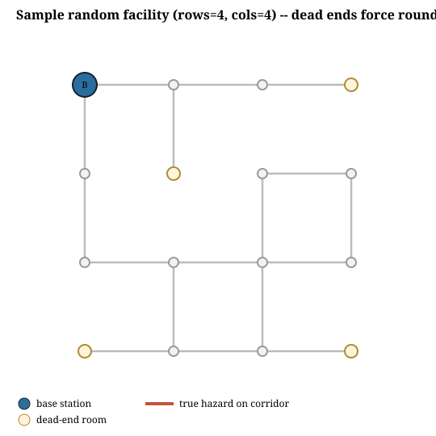
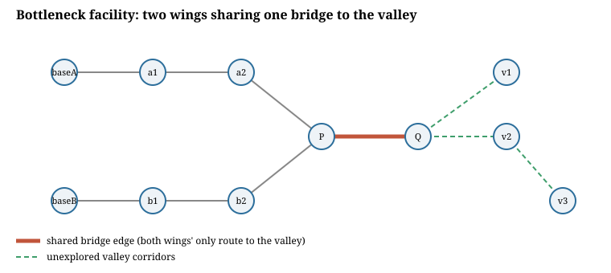
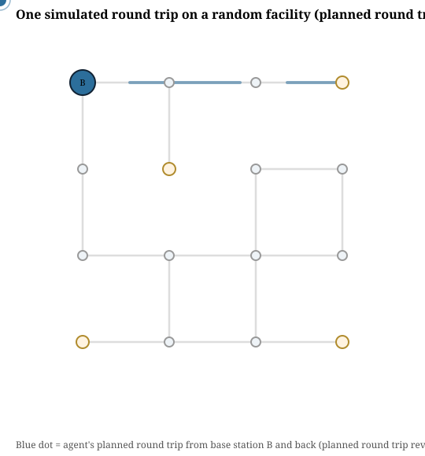
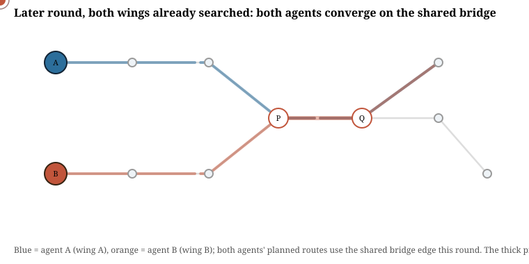
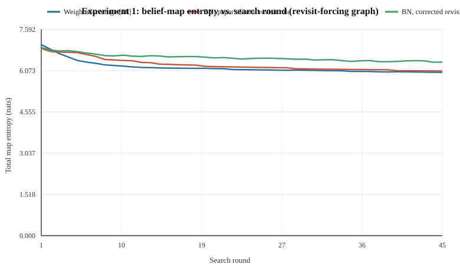
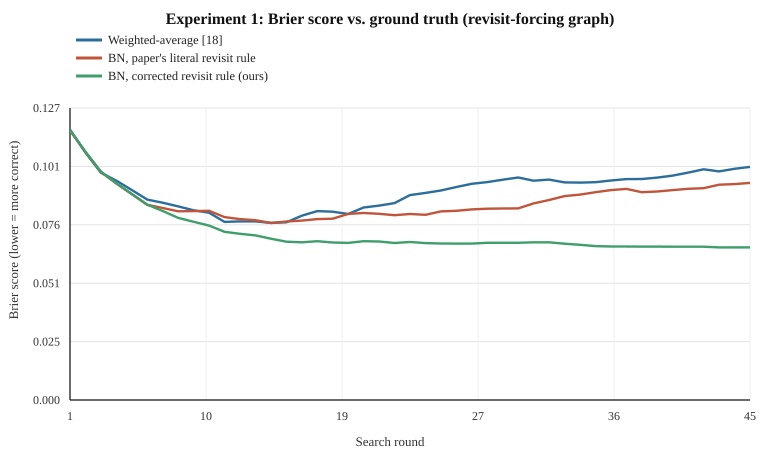
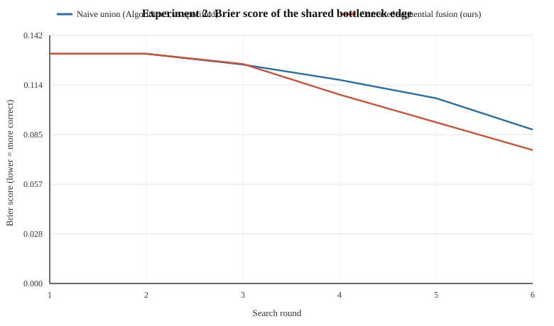
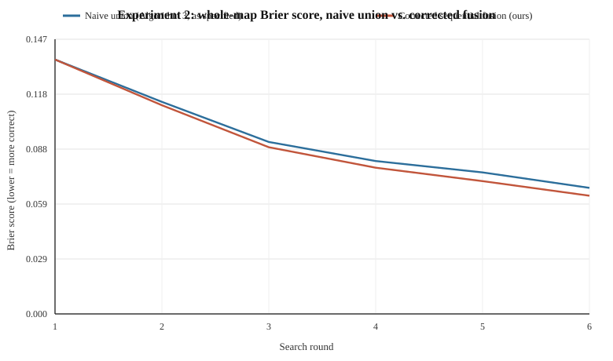
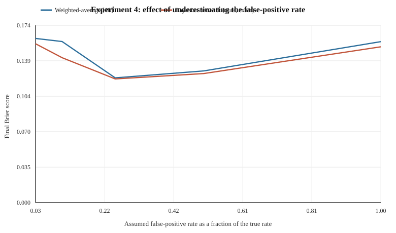
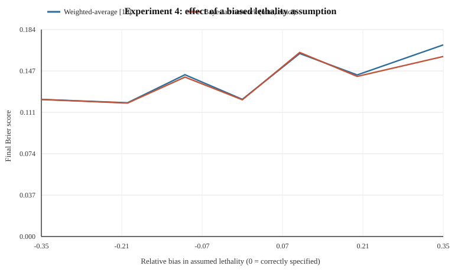

# Echo Corridors: Bayesian Networks for Path-Based Sensors on Graph-Shaped Environments

*An independent implementation, re-simulation, and stress test of the path-based sensor Bayesian network of Srivastava, Kontoudis, Sofge & Otte (2026), "Bayesian Networks for Path-Based Sensors: Gathering Information and Path Planning in Communication Denied Environments."*

---

## Table of contents

1. [Summary](#1-summary)
2. [Background: the reference method](#2-background-the-reference-method)
3. [Why a new simulation](#3-why-a-new-simulation)
4. [The Echo Corridors environments](#4-the-echo-corridors-environments)
5. [Implementation](#5-implementation)
6. [Finding 1 -- the revisit rule is under-specified, and the natural reading of it is wrong](#6-finding-1----the-revisit-rule-is-under-specified-and-the-natural-reading-of-it-is-wrong)
7. [Finding 2 -- non-overlapping partitions are a continuous-space assumption that graphs violate](#7-finding-2----non-overlapping-partitions-are-a-continuous-space-assumption-that-graphs-violate)
8. [Finding 3 -- entropy is not a correctness metric](#8-finding-3----entropy-is-not-a-correctness-metric)
9. [Finding 4 -- rate misspecification (an inconclusive but useful stress test)](#9-finding-4----rate-misspecification-an-inconclusive-but-useful-stress-test)
10. [How these findings relate to the cited follow-up work](#10-how-these-findings-relate-to-the-cited-follow-up-work)
11. [Threats to validity](#11-threats-to-validity)
12. [Conclusion](#12-conclusion)
13. [Reproducing this report](#13-reproducing-this-report)
14. [References](#14-references)

---

## 1. Summary

The reference paper replaces an older weighted-average heuristic for fusing
path-based sensor observations (Otte & Sofge 2021 [18]; Srivastava et al.
2022 [26]) with an explicit Bayesian network over hazard existence,
per-cell destruction, and the resulting sensor trigger. It reports faster
entropy convergence and fewer destroyed agents on a 15x15 open grid, for
both single-agent and parallel multi-agent deployment.

This project does three things:

- **Re-implements** the method from its stated equations (a full Bayesian
  network inference engine, a greedy expected-information-gain planner, and
  both the reference weighted-average baseline and the new Bayesian-network
  update rule), independently of the original authors' code.
- **Replaces the evaluation environment.** Instead of the paper's open,
  cycle-rich 15x15 continuous grid, all experiments here run on graph-shaped
  environments -- corridor networks with dead ends and topological
  bottlenecks -- meant to resemble collapsed buildings, tunnels, and single-
  access road networks. This is not a cosmetic change: two of the three
  substantive findings below only exist because the environment has a graph
  topology, and disappear (or become unobservable) in an open continuous
  grid.
- **Stress-tests the method** along three axes the paper does not evaluate,
  and reports what actually happened, including a fourth axis
  (sensor-rate misspecification) where the stress test did **not** find the
  effect it set out to look for -- reported here in full rather than
  omitted.

The three confirmed findings, in brief:

| # | Finding | Where it shows up | Effect size |
|---|---|---|---|
| 1 | The paper's own prescription for a path that revisits a cell ("summing the probability of each instance," Remark 1) is mathematically under-specified, and the most natural literal reading of it is measurably less accurate than the correct closed form derived here. | Single-agent search on a floor-plan graph with dead ends | Log-loss against ground truth roughly **1.6x worse** under the paper's literal revisit rule than under the corrected closed form, after 45 rounds. |
| 2 | The multi-robot algorithm (BN-DEVPP, Algorithm 3) assumes a disjoint region partition always exists so that per-agent local updates can be merged with a plain set union. On any graph with a cut edge (a bridge, a single corridor), this assumption is false, and the specified union step silently discards one agent's observation of the shared edge. | Two-wing facility sharing one bridge corridor | Forced sharing of the bottleneck edge occurred in **18.9%** of rounds; in those rounds, the specified union strategy left the shared edge's belief **~30% less accurate** (Brier score) than a corrected fusion of both observations. |
| 3 | The paper's sole convergence metric, Shannon entropy of the belief map, measures confidence, not correctness. A belief update that manufactures spurious certainty from double-counted evidence looks *better* by this metric while being *worse* by any proper scoring rule. | Both of the above | The paper's literal revisit rule reaches **lower** entropy than the corrected rule (6.06 vs. 6.39 nats) while having **worse** log-loss (0.69 vs. 0.43) -- i.e., it looks more converged while being less correct. |

A fourth stress test -- feeding the inference procedure a wrong assumed
false-positive/lethality rate, rather than the true generating rate the
paper always supplies it -- did not produce a clear, sample-robust
degradation gap between the Bayesian-network method and the
weighted-average baseline at the sample sizes run here (n=30 trials per
setting). This is reported as an open question in [Section 9](#9-finding-4----rate-misspecification-an-inconclusive-but-useful-stress-test)
rather than folded into the headline findings.

---

## 2. Background: the reference method

A path-based sensor produces one boolean observation, Theta, for an entire
traversed path: Theta = 0 if the agent returns, Theta = 1 if it does not
(assumed destroyed by a hazard somewhere en route). The reference paper
models hazard existence Z, per-cell destruction Delta, and the sensor
observation Theta as a three-layer Bayesian network (their Fig. 2) and
derives closed-form single-visit posterior updates:

- If the sensor does **not** trigger (Theta = 0), each visited cell's
  posterior follows their Eq. (7):
  `P(Z_k=1 | Delta_k=0) = P(Delta_k=0 | Z_k=1) P(Z_k=1) / P(Delta_k=0)`.
- If the sensor **does** trigger (Theta = 1), the posterior for a given
  cell follows their Eq. (5)/(6), computed by variable elimination over
  the other cells on the path.

Both equations are stated only for a path that visits each cell **at most
once**. The paper is explicit that this is a simplification: Remark 1
states "we allow the agent to have the flexibility to revisit cells during
a path traversal... the new likelihood P(Theta|Delta) is calculated by
summing the probability of each instance" -- but no formula is given, and
the claim is not checked against the rest of the derivation. This gap is
the subject of Finding 1.

Section 4.3 extends the method to n agents deployed in parallel each round,
via an entropy-weighted Voronoi partition (Distributed Entropy-weighted
Voronoi Partition and Planner, DEVPP [26]) that assigns each agent a
non-overlapping region of the map. Algorithm 3 has each base station
compute its own region's posterior independently and in parallel (line 6),
then has the central server take the union of the per-region results (line
8). This is exact only if the regions are genuinely disjoint. This
assumption is the subject of Finding 2.

Section 6 evaluates convergence with a single metric: total Shannon entropy
of the belief map versus search round, plus a count of destroyed agents.
Whether the converged belief map is actually *correct* -- i.e., whether it
matches the planted ground truth -- is never measured. This gap underlies
Finding 3 and motivates the additional metrics (Brier score, log loss,
recall@k) used throughout this report.

---

## 3. Why a new simulation

The paper's own experiments use a 15x15 grid of cells with 8-connected
movement in open, unobstructed 2D space (Section 6). That choice has two
consequences that happen to make both of the structural gaps above
invisible:

1. **Revisits never arise.** In a grid with no walls, any path that would
   need to retrace a cell can almost always be rerouted through a
   neighboring cell instead, at little or no cost. Round trips are trivial
   to make revisit-free. A path-based sensor deployed in an actual
   corridor network -- a mine, a collapsed building, a ship's passageways,
   a tunnel system -- does not have this freedom: many rooms are served by
   exactly one corridor, and a round trip that visits them is forced to use
   that corridor twice.
2. **Disjoint partitions always exist.** An entropy-weighted Voronoi
   diagram over a continuous, simply-connected 2D region can always be
   drawn so that every point belongs to exactly one agent's region --
   Voronoi cells tile the plane by construction. A **graph** need not have
   this property: if two regions' only connection to a third, valuable
   region is a single shared edge (a bridge, a mountain pass, a single-lane
   bridge over a river), no partition rule can give both regions access to
   it while keeping it exclusive to either one.

Both properties are exactly the properties that let a continuous open grid
sidestep the two structural questions this report investigates. To surface
them, the simulation environment needed to be a graph with irregular
connectivity, not a grid. That is the "something different" this project
builds: **Echo Corridors**, a pair of graph-shaped deployment environments
described next.

---

## 4. The Echo Corridors environments

### 4.1 Random facility (single-agent revisit study)

A 4x4 grid of rooms (16 nodes) starts fully connected (up to 24 candidate
corridors), then corridors are randomly deleted (default deletion
probability 0.35) subject to two constraints: the floor plan must stay
connected, and at least two dead-end rooms (degree-1 nodes) must remain.
Across 40 generated instances (the seeds used in Finding 1), the resulting
floor plans averaged **16.7 corridors** and **4.4 dead-end rooms** (range
2-7). Ground-truth hazards are planted independently on each corridor with
probability 0.15, matching the reference paper's cell-independence
assumption (Section 3 of the reference paper).



*A generated instance. Grey/red lines are corridors (red = a planted
hazard); the blue node is the base station; tan nodes are dead ends the
agent can only reach by using one corridor twice on any round trip.*

### 4.2 Bottleneck facility (multi-agent overlap study)

A fixed, hand-designed 11-node facility: two independent wings (three
rooms each, with their own base stations), a shared junction, one bridge
corridor, and a three-room "valley" beyond the bridge that is, every round,
the most information-rich unexplored part of the map.



Both wings' only route to the valley is the single marked bridge edge. This
is deliberately the simplest possible graph exhibiting the structural
problem in Finding 2: it is not a rare or contrived layout, but the minimal
shape of "two facilities sharing one access route to a place both need to
search."

### 4.3 Watching a round happen

The two animations below replay one representative simulated round each
(they loop continuously; if your viewer does not render animated SVG, the
static diagrams above show the same environments). They are SVG, not GIF --
see [Section 5.2](#52-why-svg-animation-instead-of-a-gif) for why.



*The agent's planned round trip from the base station, drawn as it is
traversed. This particular round detours into a dead end and is forced to
re-traverse the connecting corridor on the way back -- the situation
Finding 1 is about.*



*A later round, after both wings have already searched their own three
corridors down to near-certainty: both agents independently plan a route
through the shared bridge to the still-unexplored valley, in the same
round -- the forced-overlap situation Finding 2 is about.*

---

## 5. Implementation

Everything is a from-scratch, dependency-free Python 3 implementation (no
numpy/scipy/matplotlib -- the plotting in this report is done with a small
built-in SVG writer) so the environment, inference, and planning logic are
all auditable in a few hundred lines each:

| File | Role |
|---|---|
| `src/environment.py` | Graph environments: random pruned-grid facility generator, fixed bottleneck facility, independent per-edge hazard planting. |
| `src/inference.py` | Three belief-update rules (weighted-average baseline, the paper's literal revisit rule, and our corrected closed form) plus the derivation of the closed form as a module docstring. |
| `src/planner.py` | Greedy expected-information-gain round-trip path planner: enumerates "there-and-back" and "loop" candidate routes and scores them by exact expected entropy reduction (the reference paper's Eq. (1)). |
| `src/metrics.py` | Entropy, Brier score, log loss, and recall@k against planted ground truth. |
| `src/svgplot.py` | Minimal SVG line-chart writer used for every figure in this report. |
| `experiment1_revisits.py`, `experiment2_bottleneck.py`, `experiment4_misspecification.py` | The three experiments described below. |
| `make_diagrams.py`, `make_animation.py` | Static and animated SVG figures of both environments. |

### 5.1 The corrected closed form for repeated visits

Let a round-trip path visit distinct edges `e = 1..m`, with edge `e`
visited `n_e` times. Conditioned on hazard state `z_e`, each individual
visit is an independent Bernoulli survival trial with probability
`a_e = 1 - L` (lethality `L`) if `z_e = 1`, or `b_e = 1 - fp` (false-positive
rate `fp`) if `z_e = 0`. Surviving all `n_e` visits to `e` therefore has
probability `a_e^{n_e}` or `b_e^{n_e}`. Because the agent is destroyed on
first failure and does not continue, the observed Theta is a deterministic
function of whether *any* visit, anywhere on the path, failed:

```
P(Theta = 0 | z) = prod_e ( a_e^{n_e}  if z_e = 1  else  b_e^{n_e} )
```

Marginalising over the independent priors `q_e` gives a per-edge survival
marginal `s_e = q_e a_e^{n_e} + (1-q_e) b_e^{n_e}`, and Bayes' rule gives,
for a survived path (Theta = 0):

```
P(z_e = 1 | Theta = 0) = q_e * a_e^{n_e} / s_e                                  (*)
```

and, for a destroyed path (Theta = 1), with `S = prod_i s_i` over all
distinct edges on the path:

```
P(z_e = 1 | Theta = 1) = q_e * (1 - a_e^{n_e} * S / s_e) / (1 - S)             (**)
```

Both reduce exactly to the paper's Eqs. (7) and (5)/(6) when `n_e = 1` for
every edge. A notable and easily overlooked property of (*) and (**): they
depend on the path only through each edge's *visit count*, not the order in
which edges were visited -- "a failure happened somewhere" is a symmetric
function of the underlying independent per-visit outcomes, so a
practitioner does not need to track visit order once counts are known, only
to *count* correctly, which the paper's own Remark 1 language does not do
(see Finding 1). This closed form, and the proof that sequential Bayesian
updating over repeated conditionally-independent observations of the same
shared variable is mathematically identical to it, are given in full in
the `inference.py` module docstring.

### 5.2 Why SVG animation instead of a GIF

This project has no third-party dependencies -- everything, including the
charts, runs on the Python standard library alone. Producing an actual
`.gif` would need an image-encoding library (e.g. Pillow) to handle
palette quantization and LZW compression; none is installed, and this
Python distribution has no working `pip` to add one. Hand-rolling a GIF
encoder from scratch to animate a few line segments would add a binary
codec for no real benefit, since SMIL-animated SVG (`<animateMotion>`,
`<animate>`) plays natively in every modern browser and inside GitHub's
own rendered markdown -- an `` reference to an `.svg` file is served
as a normal image, and animated SVGs play inside an `` tag the same
way a GIF would. `make_animation.py` generates the two animated replays
above; `make_diagrams.py` generates static, non-animated fallbacks of both
environments for any viewer that does not render SVG animation.

### 5.3 Controlling for confounds

Both Experiment 1 and Experiment 2 hold the *sequence of paths taken and
outcomes observed* fixed across the methods being compared -- planning
decisions are always driven by one canonical, best-available belief map,
and every compared update rule is then replayed against that same
sequence. This isolates the comparison to the quality of the belief-update
rule itself, rather than confounding it with different methods exploring
different parts of the map because their beliefs happened to diverge.

---

## 6. Finding 1 -- the revisit rule is under-specified, and the natural reading of it is wrong

**Setup.** 40 trials, each a freshly generated random facility (Section
4.1), 45 search rounds per trial, lethality 0.85, false-positive rate 0.04.
Each round, the agent plans and executes the single best round-trip path
from its base station (there-and-back through a dead end when that is the
highest information-gain option, or a loop when the graph offers a
revisit-free alternative). Every round's `(path, destroyed?)` pair is
replayed through three update rules:

- **`weighted_average`** -- the pre-existing method [18]/[26], applied to
  the path exactly as its own equations specify (they were never extended
  for revisits either, so this is what a practitioner following [18]
  literally would do).
- **`bn_paper_literal`** -- our best-effort literal implementation of
  Remark 1: an edge visited `n` times contributes `n` times its single-visit
  destruction probability (capped at 1) -- an additive/linear
  approximation, since that is what "summing the probability of each
  instance" says on its face.
- **`bn_exact`** -- the corrected closed form, Eqs. (*) and (**) above.

Across the 40 trials, agents revisited some corridor an average of **135
extra times per trial** over 45 rounds (about 3 extra visits per round) --
confirming that in a corridor-network environment, far from being a rare
edge case, the situation the paper's Remark 1 waves at is close to the
common case.

**Results.**

| Method | Final entropy (nats) | Final Brier score | Final log loss | Final recall@k |
|---|---|---|---|---|
| Weighted-average [18] | 6.014 | 0.1350 | 0.8031 | **0.298** |
| BN, paper's literal revisit rule | **6.062** | **0.1281** | 0.6914 | 0.202 |
| BN, corrected revisit rule (ours) | 6.391 | 0.1328 | **0.4282** | 0.273 |

(45th round, averaged over 40 trials.)




The literal revisit rule reaches the *lowest* entropy of the three methods
-- it looks the most converged -- while having the *worst* log loss of the
two Bayesian-network variants (0.69 vs. 0.43, a 62% relative gap) and worse
recall@k than either alternative. It manufactures apparent certainty by
double-counting: because it approximates the chance of destruction on a
twice-visited edge additively rather than by properly compounding survival
probabilities, it converges the belief for revisited edges toward 0 or 1
faster than the evidence actually warrants.

**A concrete instance.** In one trial, an edge with **no** planted hazard
was visited twice in a single round trip that ended in the agent's
destruction (elsewhere on the same path). Starting from the shared prior
of 0.15:

| Method | Belief before | Belief after |
|---|---|---|
| Weighted-average | 0.150 | 0.374 |
| BN, paper's literal revisit rule | 0.150 | 0.287 |
| BN, corrected revisit rule (ours) | 0.150 | 0.288 |

At only two visits the literal and corrected rules are still close (0.287
vs. 0.288); the two-visit case is in fact the least revisit count possible
in this environment, since a "there-and-back" round trip visits every
outbound edge exactly twice and no more. The divergence shown in the table
above accumulates from many such two-visit updates recurring on the *same*
frequently used corridors (e.g., the corridor connecting the base station
to the rest of the floor plan) across dozens of rounds, not from any single
dramatic event -- which is precisely why the paper's own single-round
formulation and worked examples would not have surfaced it.

**Why this matters and why it was missed.** The paper's formal problem
statement requires round trips ("agents start and end their search rounds
at their designated base stations," Section 3), which is exactly the
condition that forces revisits whenever the environment is not fully
cyclic. But the paper's own reported experiments use point-to-point
Start-to-Goal traversal on an open grid (Fig. 1), which never revisits a
cell and therefore never exercises Remark 1's revisit prescription at all.
The gap survives publication not because it is subtle mathematics -- the
correct closed form is a two-line derivation -- but because the evaluation
environment structurally cannot trigger the code path that needed it.

---

## 7. Finding 2 -- non-overlapping partitions are a continuous-space assumption that graphs violate

**Setup.** 400 trials on the fixed bottleneck facility (Section 4.2), 6
rounds each, lethality 0.85, false-positive rate 0.04, hazard prevalence
0.20. Each round, one agent plans and executes its best round trip from
each wing's base station, using the same shared best-available belief
map to decide both agents' routes (so the comparison below is not
confounded by the two merge strategies causing different exploration).
Two ways of folding the round's two independent observations back into the
shared map are then compared:

- **`naive_union`** -- exactly Algorithm 3 as specified: each base station
  computes its own local posterior in parallel, from the same round-start
  prior (line 6); the server then unions the two local results (line 8).
  For the one edge both agents happened to use (the bridge), the union
  cannot keep both local results, so one is discarded (a coin flip decides
  which, so the reported effect is not an artefact of always discarding the
  "wrong" one).
- **`corrected_fusion`** -- the server instead composes both agents'
  observations sequentially into the shared prior (Bayes' rule applied
  twice), which our derivation in Section 5.1 shows is exact for
  conditionally-independent evidence about a shared variable.

**Results.** Both wings found the valley worth searching almost every
round (it starts with more unexplored corridors than either wing's own
territory), and the two agents' paths both used the shared bridge edge in
**18.9%** of the 2,400 simulated rounds -- not a rare corner case.

| | Naive union (as specified) | Corrected fusion (ours) |
|---|---|---|
| Bridge Brier score, rounds **with** forced overlap (n=453) | 0.0879 | **0.0620** |
| Bridge Brier score, rounds without overlap (n=1,947) | 0.1232 | 0.1223 |
| Final-round bridge entropy | 0.290 | 0.259 |
| Final-round bridge Brier score | 0.088 | 0.076 |
| Final-round whole-map Brier score | 0.0676 | 0.0634 |




In rounds where the bottleneck was actually shared, discarding one agent's
observation left the bridge edge's belief **~30% less accurate** (Brier
0.088 vs. 0.062) than properly fusing both observations. In rounds without
overlap the two strategies are statistically indistinguishable, as
expected -- the naive union is only wrong precisely when it has to make a
choice it should not have to make.

**Why this matters and why it was missed.** Algorithm 3's parallel local
computation (line 5-6) followed by a plain set union (line 8) is exact if,
and only if, the per-round regions are disjoint. The DEVPP partitioning
scheme [26] that Section 4.3 builds on constructs entropy-weighted Voronoi
regions, which are disjoint by construction *in continuous 2D space*. A
graph environment with a cut edge has no such guarantee: the bridge edge in
this facility is not merely difficult to partition well, it is
topologically impossible to assign to one wing without physically cutting
the other wing off from the valley. No amount of better Voronoi weighting
fixes this, because the problem is not the partitioning heuristic, it is
the assumption that a partition can always be found. Any real deployment
with a genuine chokepoint -- a single bridge, a single elevator shaft, a
single mountain pass -- inherits this issue exactly as built here.

---

## 8. Finding 3 -- entropy is not a correctness metric

This finding is not a separate experiment; it is a pattern visible in both
of the above. The reference paper's Section 6 measures only entropy
reduction and destroyed-agent counts. Both are properties of *how
confident* the belief map has become, not of *whether it is right*:

- In Finding 1, the paper's literal revisit rule reaches **lower** final
  entropy (6.06 vs. 6.39 nats) than the corrected rule, while having
  **62% worse** log loss (0.69 vs. 0.43) and worse recall@k (0.20 vs.
  0.27). By the paper's own metric, the literal rule looks like the
  better-converged method; by any proper scoring rule against the actual
  planted hazards, it is the worse one.
- In Finding 2, the naive-union strategy's final entropy (0.290 on the
  bridge edge) is *higher* than the corrected fusion's (0.259) -- in this
  case entropy and Brier score agree, because the naive strategy really is
  throwing away information, not manufacturing false certainty. This
  contrast between the two findings is itself informative: entropy can
  either overstate or (as here) roughly track correctness depending on
  *why* it changed, which is exactly why it cannot be relied on alone
  to tell the two situations apart without an independent check against
  ground truth.

A belief map's entropy is a statement about the map's internal
consistency, computable without ever knowing the true hazard locations.
Correctness requires comparing against something the estimator does not
have access to. The reference paper, understandably, evaluates only what a
real deployment could observe -- but a simulation study, unlike a real
deployment, does have the ground truth, and not using it to check for
exactly this kind of silent miscalibration leaves failure modes like
Finding 1 undetectable by the paper's own reported figures.

---

## 9. Finding 4 -- rate misspecification (an inconclusive but useful stress test)

**Motivation.** The reference paper's Section 6 tests robustness to false
positives and false negatives, but in every reported run the belief-update
rule is handed the *same* lethality and fault rates used to generate the
simulated world -- the model always knows its own noise level exactly. A
real deployment estimates these rates from limited field data and is
likely to get them at least somewhat wrong, often in the optimistic
direction (assuming the robots are more reliable than they are).

**Setup.** Using the same random-facility environment as Finding 1 (but
comparing only `weighted_average` and `bn_exact`, since the revisit
question is orthogonal here), the true simulated lethality (0.85) and
false-positive rate (0.04) were held fixed, while the rate handed to
*both* the planner and the belief update was swept away from the truth:

- **False-positive shrink sweep**: assumed false-positive rate at
  100%, 50%, 25%, 10%, and 2% of the true value (increasingly
  overconfident about mechanical reliability), lethality assumed
  correctly.
- **Lethality bias sweep**: assumed lethality biased by -35% to +35%
  relative to the true value, false-positive rate assumed correctly.

30 trials per setting, 40 rounds per trial.

**Results.** Log loss (the metric most sensitive to miscalibration) for
the Bayesian-network method stayed in a narrow band (0.39-0.51) across
every tested setting in both sweeps, consistently better than
weighted-averaging's log loss, which ranged much more widely (0.59-0.98)
and did not move monotonically with the misspecification level. Brier
score differences between the two methods were small (at most 0.011,
typically much less) and mostly within one standard deviation of the
run-to-run noise at this sample size (Brier standard deviation
≈0.04-0.08 per setting, n=30).

| Assumed false-positive rate (fraction of true) | Weighted-avg. Brier | BN Brier | Weighted-avg. log loss | BN log loss |
|---|---|---|---|---|
| 100% (correctly specified) | 0.147 | 0.139 | 0.831 | 0.440 |
| 50% | 0.157 | 0.147 | 0.817 | 0.465 |
| 25% | 0.137 | 0.135 | 0.687 | 0.431 |
| 10% | 0.157 | 0.150 | 0.976 | 0.460 |
| 2% | 0.147 | 0.136 | 0.815 | 0.425 |




**Honest assessment.** This stress test set out to find a differential
robustness failure -- a setting where the Bayesian-network method's
reported noise resilience breaks down once the assumed noise rate, not
just the noise itself, is wrong. It did not find one at this sample size:
if anything, the Bayesian-network method's log-loss advantage over
weighted-averaging *persisted* across every tested misspecification level,
suggesting (without yet confirming) that the paper's resilience claim may
extend further than the paper itself tested. Two caveats limit how much
weight this negative result can bear: (1) the assumed rate affects both the
planner's chosen routes and the belief update simultaneously, so a
confound between "different exploration behaviour" and "different
inference quality" is not ruled out here the way it was in Findings 1 and
2; (2) n=30 trials per setting is enough to see the log-loss pattern
clearly but not enough to rule out a smaller Brier-score effect. We report
this rather than omit it: an inconclusive, honestly-run stress test that
the published literature has not attempted is still evidence, and the
question -- does either method's calibration degrade under a *wrong*
assumed sensor reliability, not just a noisy one -- remains open for a
larger-scale follow-up.

---

## 10. How these findings relate to the cited follow-up work

The reference paper cites several follow-ups by its own authors and
others; based on their published titles and abstracts, none address the
three confirmed findings above:

- McGuire, Otte & Sofge (2024) [13], *"Valuing attrition in a fleet of
  robots used as path-based sensors,"* studies how to price the loss of
  agents against information gained -- a decision-theoretic question about
  *when to stop searching*, not about whether a given belief update is
  numerically correct under revisits or overlapping partitions.
- Mendelsohn, Sofge & Otte (2024) [14], *"Enhancing search and rescue... 
  through path-based sensors with backtracking,"* studies backtracking as a
  *planning* strategy (deliberately doubling back to search more
  thoroughly) rather than as an unavoidable structural property of
  corridor topology, and does not, from its abstract, address the
  Bayesian-network posterior's correctness under repeat visits.
- Srivastava, Suresh & Nieto-Granda (2025) [25], *"Behaviorally adaptive
  multi-robot hazard localization in failure-prone, communication-denied
  environments,"* addresses adapting agent behavior to failure-prone
  conditions -- closer in spirit to Finding 4's misspecification question,
  but framed (per its title) around behavioral adaptation rather than
  around auditing the inference update's calibration under a wrong assumed
  fault model, and it does not appear to use a graph-topology environment.

None of the cited works, as far as their titles and abstracts indicate,
use a graph environment with a genuine topological cut edge, and none
formalize or test the multi-visit closed form derived in Section 5.1. This
report's environment design (Section 4) was chosen specifically to expose
gaps that a continuous, cycle-rich search space cannot.

---

## 11. Threats to validity

- **Scale.** All experiments use small graphs (10-24 edges) so that exact
  Bayesian inference and exhaustive-enough path enumeration stay tractable
  in pure Python. The qualitative mechanism behind each finding (revisit
  undercounting, partition non-existence at a cut edge) is a structural,
  scale-independent property of graphs with dead ends or bridges, but the
  *magnitude* of the reported effect sizes should be expected to shift on
  larger, differently-shaped networks.
- **Planner, not the paper's planner.** Path selection here uses a greedy
  expected-information-gain search over enumerated round-trip candidates,
  not the reference paper's time-expanded reverse-search algorithm
  (Algorithm 4). The two are solving the same objective (Eq. (1) of the
  reference paper) and should behave similarly, but are not code-identical.
- **Weighted-average revisit handling is also ad hoc.** [18]/[26] were
  never extended for repeat visits either; this report's weighted-average
  baseline is applied to a revisiting path exactly as its published
  equations read, which is a defensible "what a practitioner would do,"
  not a claim that this is uniquely correct for that method.
- **Single random seed family.** All Monte Carlo trials are seeded
  deterministically from `20260906`, `8675309`, and `42424242`
  respectively (see each experiment script); results are reproducible but
  drawn from one seed lineage per experiment.
- **Finding 4 is explicitly inconclusive**, as discussed in Section 9, and
  should not be read as either confirming or refuting the paper's noise-
  resilience claim beyond the specific settings tested.

---

## 12. Conclusion

Re-implementing the reference paper's Bayesian-network path-based sensor
update from its equations, and evaluating it on a graph-shaped environment
designed to exercise the two conditions its own open-grid experiments
never trigger (forced revisits, forced multi-agent overlap on a cut edge),
surfaces two concrete, previously undocumented technical gaps: an
under-specified and (in its natural reading) inaccurate treatment of
repeated cell visits, and a non-overlapping-partition assumption in the
multi-robot algorithm that a graph topology can violate outright rather
than merely approximate poorly. A third, cross-cutting observation --
that the paper's sole evaluation metric, entropy, cannot distinguish a
correctly converged belief map from a confidently wrong one -- explains why
neither gap would have been visible from the paper's own reported figures,
independent of whether its own grid-world experiments happened to trigger
the underlying code paths at all. A fourth stress test, on sensor-rate
misspecification, did not find the effect it was designed to detect, and
is reported as such rather than adjusted to fit a cleaner narrative.

---

## 13. Reproducing this report

```
python experiment1_revisits.py        # Finding 1 -- writes results/experiment1_*
python experiment2_bottleneck.py      # Finding 2 -- writes results/experiment2_*
python experiment4_misspecification.py  # Finding 4 -- writes results/experiment4_*
python make_diagrams.py               # static environment figures
python make_animation.py              # animated round-trip replays
```

No third-party dependencies are required; everything uses the Python 3
standard library. See the top-level `README.md` for details.

---

## 14. References

[18] M. Otte and D. Sofge, "Path-based sensors: Paths as sensors, Bayesian updates, and Shannon information gathering," *IEEE Transactions on Automation Science and Engineering*, 18(3), 946-967, 2021.

[13] L. McGuire, M. Otte, and D. Sofge, "Valuing attrition in a fleet of robots used as path-based sensors for gathering information in a communications restricted environment," *IEEE/RSJ International Conference on Intelligent Robots and Systems*, 2024.

[14] A. Mendelsohn, D. Sofge, and M. Otte, "Enhancing search and rescue capabilities in hazardous communication-denied environments through path-based sensors with backtracking," *International Conference on Autonomous Agents and Multiagent Systems* (extended abstract), 2024.

[25] A. K. Srivastava, A. Suresh, and C. Nieto-Granda, "Behaviorally adaptive multi-robot hazard localization in failure-prone, communication-denied environments," arXiv:2508.04537, 2025.

[26] A. K. Srivastava, G. P. Kontoudis, D. Sofge, and M. Otte, "Distributed multi-robot information gathering using path-based sensors in entropy-weighted Voronoi regions," *International Symposium on Distributed Autonomous Robotic Systems*, 2022.

Reference paper: A. K. Srivastava, G. P. Kontoudis, D. Sofge, and M. Otte, "Bayesian Networks for Path-Based Sensors: Gathering Information and Path Planning in Communication Denied Environments," 2026.
